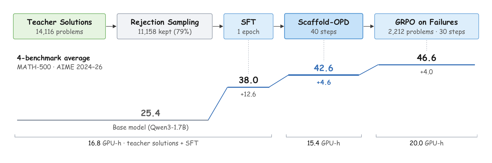
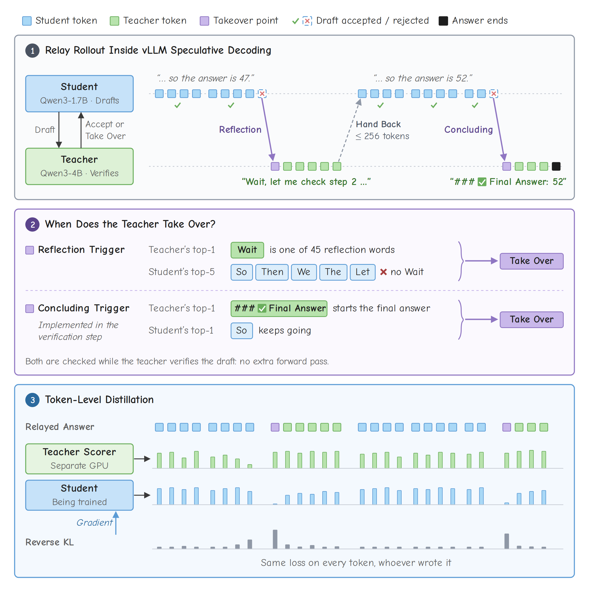

# Scaffold-OPD

Scaffold-OPD is a post-training pipeline that teaches a small language model long chain-of-thought math reasoning
from a stronger teacher. Its core stage, also called Scaffold-OPD, is on-policy distillation in which the teacher
briefly takes over the student's rollout at reflection points; the full pipeline is **SFT → Scaffold-OPD → RL**.
It is built on [veRL](https://github.com/volcengine/verl) and [vLLM](https://github.com/vllm-project/vllm). The
default setup distills Qwen3-4B-Instruct-2507 into Qwen3-1.7B on DAPO-Math and evaluates on MATH-500 and
AIME 2024/2025/2026.

Results and analysis are in the [project report](https://hey-chillax.github.io/projects/scaffold-opd.html).

## Overview

The pipeline runs five steps and evaluates the student after each training stage:

1. **Teacher data.** The teacher writes one solution per training problem.
2. **Rejection sampling.** Solutions that finish and pass a rule-based answer grader are kept.
3. **SFT.** The student is fine-tuned on the kept solutions for one epoch.
4. **Scaffold-OPD.** The student generates on-policy. Whenever the teacher's most likely next token is a
   reflection token (`Wait`, `But`, ...) outside the student's top-5, the teacher takes over for a few paragraphs
   and then hands generation back, and the whole trajectory is trained with token-level reverse-KL distillation.
   The rollout runs inside vLLM speculative decoding with the roles swapped (the student drafts, the teacher
   verifies), so finding takeover points costs no extra forward pass. An optional concluding trigger also lets the
   teacher take over to write the final answer.
5. **GRPO on failures.** Problems the teacher solved but the student never solved during Scaffold-OPD are trained
   with outcome-reward GRPO.

Every stage can also run on its own, for example Scaffold-OPD, standard OPD or GRPO directly from the base model.

<p align="center">
  
</p>

*The full pipeline: the four-benchmark average after each training stage, the gain over the previous stage, and the
GPU-hours each stage took.*

<p align="center">
  
</p>

*One Scaffold-OPD rollout and its training signal (illustration; the example text, the top-5 words and the per-token
probabilities are made up). ① The student drafts inside vLLM speculative decoding and the teacher verifies; at a
reflection point or at the conclusion, the teacher rejects the student's draft token, writes a short passage and hands
back. ② The two takeover rules. ③ The teacher scorer and the student score every token of the relayed answer; the
per-token reverse KL trains the student, whoever wrote the token.*

## Installation

Linux, NVIDIA GPUs and Python 3.12. The takeover rollout patches vLLM internals, so vLLM must be **0.21.0**.

```bash
git clone https://github.com/Hey-Chillax/scaffold-opd.git && cd scaffold-opd
uv venv --seed --python 3.12 .venv && source .venv/bin/activate
uv pip install -c environment/vllm-constraints.txt vllm==0.21.0
uv pip install -e . -r requirements-relay-opd.txt -r requirements-test.txt
python environment/verify_install.py
```

<details>
<summary>NVIDIA drivers older than R580</summary>

The default PyTorch 2.11 and vLLM 0.21 wheels are CUDA 13 builds. On older drivers, install the CUDA 12.9 builds and
pin everything else to the tested lock:

```bash
grep -vE '^(#|$|cuda-|nvidia-(cublas|cuda-|cudnn-cu13|cufft|cufile|curand|cusolver|cusparse|nccl-cu13|nvjitlink|nvshmem-cu13|nvtx))' \
  environment/requirements.lock.txt > cu129.constraints.txt
echo 'numpy==1.26.4' > cu129.overrides.txt
uv pip install --torch-backend=cu129 -c cu129.constraints.txt -c environment/vllm-constraints.txt \
  --override cu129.overrides.txt \
  'vllm @ https://github.com/vllm-project/vllm/releases/download/v0.21.0/vllm-0.21.0%2Bcu129-cp38-abi3-manylinux_2_34_x86_64.whl' \
  -e . -r requirements-relay-opd.txt -r requirements-test.txt
```

</details>

## Data

```bash
hf download Qwen/Qwen3-1.7B --local-dir models/Qwen3-1.7B
hf download Qwen/Qwen3-4B-Instruct-2507 --local-dir models/Qwen3-4B-Instruct-2507

hf download open-r1/DAPO-Math-17k-Processed --repo-type dataset --include 'en/*' --local-dir data/raw/DAPO-Math-17k-Processed
hf download HuggingFaceH4/aime_2024 --repo-type dataset --local-dir data/raw/aime_2024
hf download opencompass/AIME2025 --repo-type dataset --local-dir data/raw/AIME2025
hf download MathArena/aime_2026 --repo-type dataset --local-dir data/raw/aime_2026
hf download HuggingFaceH4/MATH-500 --repo-type dataset --local-dir data/raw/MATH-500

python pipeline/prepare_data.py --raw_dir data/raw --out_dir data
```

## Training

Run the full pipeline on one machine with at least two 80 GB GPUs:

```bash
CUDA_VISIBLE_DEVICES=0,1 bash pipeline/run_pipeline.sh --run-id demo
bash pipeline/run_pipeline.sh --run-id demo --dry-run     # print every stage's command without running it
```

Running again with the same `--run-id` resumes after the last finished stage. Single stages from the base model:

```bash
CUDA_VISIBLE_DEVICES=0,1 METHOD=scaffold bash pipeline/train_stage.sh                      # Scaffold-OPD
CUDA_VISIBLE_DEVICES=0,1 METHOD=scaffold CONCLUDE_TRIGGER=1 bash pipeline/train_stage.sh   # + concluding trigger
CUDA_VISIBLE_DEVICES=0,1 METHOD=opd bash pipeline/train_stage.sh                           # standard OPD
CUDA_VISIBLE_DEVICES=0,1 METHOD=grpo bash pipeline/train_stage.sh                          # GRPO
```

The scripts read their locations from `MODEL_DIR`, `DATA_DIR`, `OUTPUT_ROOT` and `CKPT_DIR` (defaults in
`pipeline/common.sh`), document their options in their headers, and pass extra arguments to the trainer as Hydra
overrides. Slurm wrappers are in `examples/slurm/`.

## Evaluation

```bash
CUDA_VISIBLE_DEVICES=0 MODEL=<hf model dir> OUT_DIR=outputs/eval/my_model bash pipeline/eval.sh
python3 tools/analysis/collect_results.py --eval base=outputs/eval/base --eval mine=outputs/eval/my_model \
    --pair mine:base > results.json
```

The student generates alone with temperature 1.0, top-p 1.0, up to 32k new tokens and the Qwen3 non-thinking
template; `collect_results.py` reports avg@k accuracy and per-problem paired differences with standard errors.
CPU unit tests: `python -m pytest tests/opd -q`.

## Repository structure

```text
pipeline/         end-to-end and per-stage scripts, data preparation, rejection sampling, failure mining
examples/slurm/   Slurm wrappers for the pipeline scripts
tools/analysis/   result collection, plots, evaluation and rollout statistics, contamination check
opd/              vLLM takeover-rollout patch, training launchers, math evaluator and reward
verl/             veRL with the trainer-side changes for Scaffold-OPD training
tests/opd/        CPU unit tests
environment/      pinned dependencies and the installation check
docs/figures/     figures in this README
```

## Acknowledgements

- [veRL](https://github.com/volcengine/verl) and [vLLM](https://github.com/vllm-project/vllm) for training and
  rollout.
- [Relay-OPD](https://arxiv.org/abs/2607.26057) and its [code](https://github.com/zju-real/Relay-OPD), which the
  Scaffold-OPD stage builds on.
- [Qwen3](https://github.com/QwenLM/Qwen3) for the models and [DAPO-Math](https://github.com/BytedTsinghua-SIA/DAPO)
  for the training problems.
- MATH-500, AIME 2024, AIME 2025 (OpenCompass) and AIME 2026 ([MathArena](https://matharena.ai/)) for evaluation.

## Citation

```bibtex
@article{sheng2024hybridflow,
  title   = {HybridFlow: A Flexible and Efficient RLHF Framework},
  author  = {Guangming Sheng and Chi Zhang and Zilingfeng Ye and Xibin Wu and Wang Zhang and Ru Zhang and Yanghua Peng and Haibin Lin and Chuan Wu},
  journal = {arXiv preprint arXiv:2409.19256},
  year    = {2024}
}

@inproceedings{kwon2023vllm,
  title     = {Efficient Memory Management for Large Language Model Serving with PagedAttention},
  author    = {Woosuk Kwon and Zhuohan Li and Siyuan Zhuang and Ying Sheng and Lianmin Zheng and Cody Hao Yu and Joseph E. Gonzalez and Hao Zhang and Ion Stoica},
  booktitle = {Proceedings of the 29th Symposium on Operating Systems Principles},
  year      = {2023}
}

@article{xu2026relayopd,
  title   = {Pass the Baton: Trajectory-Relayed On-Policy Distillation},
  author  = {Haolei Xu and Xiaowen Xu and Haiwen Hong and Zixuan Ni and Hongxing Li and Yiwen Qiu and Weiming Lu and Yongliang Shen},
  journal = {arXiv preprint arXiv:2607.26057},
  year    = {2026}
}

@article{yang2025qwen3,
  title   = {Qwen3 Technical Report},
  author  = {An Yang and others},
  journal = {arXiv preprint arXiv:2505.09388},
  year    = {2025}
}

@article{yu2025dapo,
  title   = {DAPO: An Open-Source LLM Reinforcement Learning System at Scale},
  author  = {Qiying Yu and others},
  journal = {arXiv preprint arXiv:2503.14476},
  year    = {2025}
}
```

## License

Apache License 2.0; see `LICENSE` and `Notice.txt`. The AIME 2026 problems from MathArena are licensed CC BY-NC-SA 4.0.
